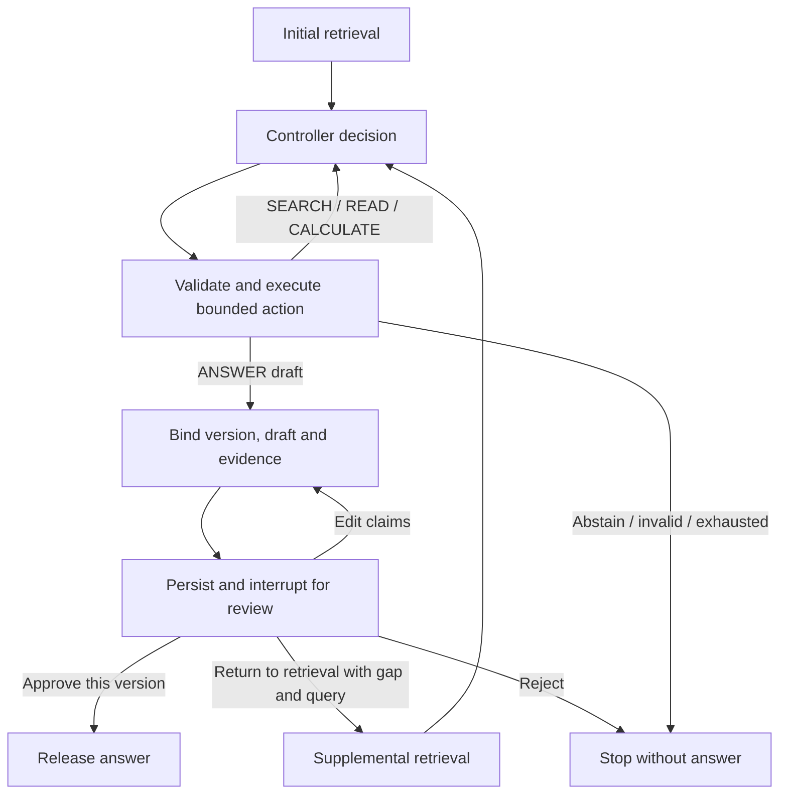

# Durable local Agent review with LangGraph

The preferred Agent prototype is now `ReviewAgent` in `agent_graph.py`. It uses
LangGraph nodes and a SQLite checkpointer for retrieval, controller decisions,
bounded tool execution and human review. The older `InsuranceAgent.run` and
`agent_demo` remain as a regression reference; they do **not** implement review.
The main document-packet application is unchanged.

Every `ANSWER` action produces a **draft**, never a released answer. A draft
always pauses for explicit operator review. Human edits create a new version
and pause again. The trigger is deliberately unconditional; there is no
model-controlled risk score that can bypass approval.



## Install and run a synthetic session

From the repository root:

```bash
python -m pip install -r requirements-agent.txt
python -m src.insurerag_vlm.agent_graph_demo start --thread-id example-1
python -m src.insurerag_vlm.agent_graph_demo status --thread-id example-1
```

This demo uses the fictional Cedar fixtures and a scripted controller. It makes
no model call. Its fixed retriever supplies stable fixture IDs across process
restarts. The graph also accepts the existing `HybridRetrieverAdapter`; a test
executes the real local hashing/sparse hybrid pipeline and insurance reranker
with a scripted controller. Neither demonstration is a model-quality evaluation.
No holdout question, gold answer or TEST result is used.

The default private database is `.agent-state/review.sqlite`, ignored by Git.
Keep the database, lock file, draft evidence and review files local. Use the same
`--db`, `--thread-id`, `--scenario` and controller settings after restarting.
`start` on the same question resumes unfinished work or returns the current
pause/result. It does not erase the thread or generate another answer. `status`
only reads state.

The returned `result.approval` shows the draft, exact evidence, calculations,
version and `approval_id`. Copy those two binding values into a JSON file:

```json
{
  "decision_id": "review-1",
  "reviewer": "local-operator",
  "version": 1,
  "approval_id": "COPY_FROM_THE_PENDING_APPROVAL",
  "action": "approve"
}
```

Save it locally, for example `.agent-state/decision.json`, and submit:

```bash
python -m src.insurerag_vlm.agent_graph_demo resume --thread-id example-1 --decision .agent-state/decision.json
```

There is no default decision and no timeout approval. Inspect **`answer`** for
released content; `draft` and `approval.draft` are unapproved review material.
Approval records identify a local operator label; the label is not authenticated.
This is a trusted single-machine CLI/API, not a deployed multiuser approval service.

| Action | Required extra fields | Result |
|---|---|---|
| `approve` | None | Release only the bound draft version |
| `edit` | `claims` in the existing claim/citation schema | Validate exact citations, increment version, pause for another review |
| `retrieve` | A new `query` and concrete `gap` | Spend remaining retrieval/model budgets, produce a new draft, pause again |
| `reject` | None | Stop with `answer: null` |

All commands require `decision_id`, `reviewer`, `version`, `approval_id` and
`action`. No extra keys are allowed. Editing preserves the original evidence:
use `retrieve` first if new evidence is needed. An edit is not an approval.
Use a new `decision_id` for each new decision. Exact duplicate submissions return
the current state without applying the decision again; conflicting reuse of an
ID fails. A prior version or another thread's approval cannot authorize release.

## Persistence and recovery contract

The graph checkpoints after each node with synchronous durability. The review
node calls LangGraph `interrupt`; resume uses `Command(resume=...)` with the
original `thread_id`. Draft preparation and decision application are separate
nodes, so re-entering the interrupt cannot regenerate a draft or perform a tool
call. These semantics follow the official
[interrupt documentation](https://docs.langchain.com/oss/python/langgraph/interrupts)
and [persistence documentation](https://docs.langchain.com/oss/python/langgraph/persistence).

The approval digest binds the thread, question, runtime configuration, version,
draft, read evidence and calculations. Runtime identity and budgets are stored
in the checkpoint and checked on reopen. Application integrators must supply
an immutable `runtime_id` covering their corpus snapshot and model/configuration.
Changing those inputs without changing the identity is outside this contract.

A database-wide OS file lock serializes local API operations, including across
processes. The OS releases it on process exit; a concurrent request gets
`BusyError`. A separate SQLite operation table stores completed retrieval/model
results. A crash after result persistence but before the graph checkpoint reuses
the result. A crash **during** a call leaves a durable started marker: recovery
stops with `uncertain_operation` and does not repeat that call automatically.
Preserve that database and investigate before deliberately starting a new thread.
This provides conservative recovery, not a claim of distributed exactly-once
execution for arbitrary external services.

Decision records in graph state reconcile crashes after the interrupt or decision
checkpoint. Repeating the same command completes pending graph work without
applying the decision twice. No external publication or other side effect occurs
when an answer is approved; release here means setting the local `answer` field.

SQLite contains sensitive drafts and evidence in plaintext. Keep it on private,
local storage; do not share it or open untrusted databases. Tracing is explicitly
disabled for graph sessions. Authentication, role separation, encrypted storage,
multi-host concurrency and an approval web UI are not implemented.

## Budget and evidence boundaries

The bounded `SEARCH`, `READ`, `CALCULATE`, `ANSWER` and `ABSTAIN` contract is retained.
Defaults remain eight controller calls, three supplemental searches, 512 reserved
output tokens per call, 24,000 charged tokens and 8,192 context tokens. Charging
uses prompt UTF-8 bytes plus overhead and reserved output; it is conservative
accounting, not tokenizer-measured usage. Provider usage is recorded separately.
Returning to retrieval does not reset budgets. A human-directed retrieval round
may reconsider a prior answer; repeated queries and repeated actions within a
round are still rejected.

The 60-second active-call budget excludes time waiting for human review; each
dependency call also has a 15-second cap. Results arriving after a cap are
discarded. Local retrieval is synchronous and checked before/after the call,
not forcibly killed. Hard cancellation still needs an isolated worker.

Exact quotation checks do not prove entailment. The operator must review
jurisdiction, dates, missing conditions, numerical interpretation and whether
the claims follow from the evidence. A mechanically valid human edit can still
be wrong. This prototype has no independent expert validation and must not be
used to adjudicate a real person's insurance claim.

## Validation and actual model availability

Run the named local tests:

```bash
python -m pytest -q tests/test_agent_graph.py tests/test_agent_draft.py
```

They cover approval/edit/retrieval/rejection, missing or stale approval,
cross-thread binding, duplicate/conflicting commands, real subprocess restart,
concurrent process exclusion, crashes during calls and between durable writes,
retained budgets, exact citation validation and rejected tool injection.
The [verification report](../reports/agent_langgraph/status_20261020.json) records
the actual result and runtime probe. These are synthetic control-flow tests.

On 2026-10-20, the read-only probe of `127.0.0.1:11434/api/tags` failed with
`ConnectionError`; no Ollama executable on PATH, process, standard per-user model
store or configured alternate host was found in the checked locations. No
generator call, model download, paid API or service startup was performed.
An existing model can later be tested on one synthetic scenario:

```bash
python -m src.insurerag_vlm.agent_graph_demo start --thread-id local-model-1 --controller ollama --scenario ordinary --model ollama:qwen3.5:4b --expected-digest VERIFIED_LOCAL_DIGEST
```

Use identical settings for status/resume. Verify the local model identity first;
the historical digest is not proof that a model is available now.
The CLI creates the local model adapter lazily on the first generation call.
Viewing, editing, rejecting or approving a saved draft therefore works even
while Ollama is offline; returning to retrieval may require generation again.

Data work is preserved separately: pool 172 contains 1,000 provisional TEST,
57 DEV and 186 TEST families; the unchanged task quotas are met. **Accepted=0,
frozen=false**. Necessary support covers 872 items/1,047 units/88 refusal diagnostics;
mapping is 889 complete/111 pending. The remaining 128 support reviews comprise
17 mapped but source-issue-blocked items and 111 unmapped items. There are 24 pending
sources and 15 open issues. Source exclusions affect no active QA or existing support.
All historical withdrawals remain in force. See the [count reconciliation](HOLDOUT_REVIEW_LAYERS_ZH.md)
and [current aggregate](../reports/holdout1000_v1/stage781_progress.json).
LangGraph implementation is unchanged. Real generation remains paused under the
prior Ollama-unavailable record; no model download, paid API, final holdout inference
or tuning on TEST results occurred. Synthetic workflow verification is not real-model effectiveness.
